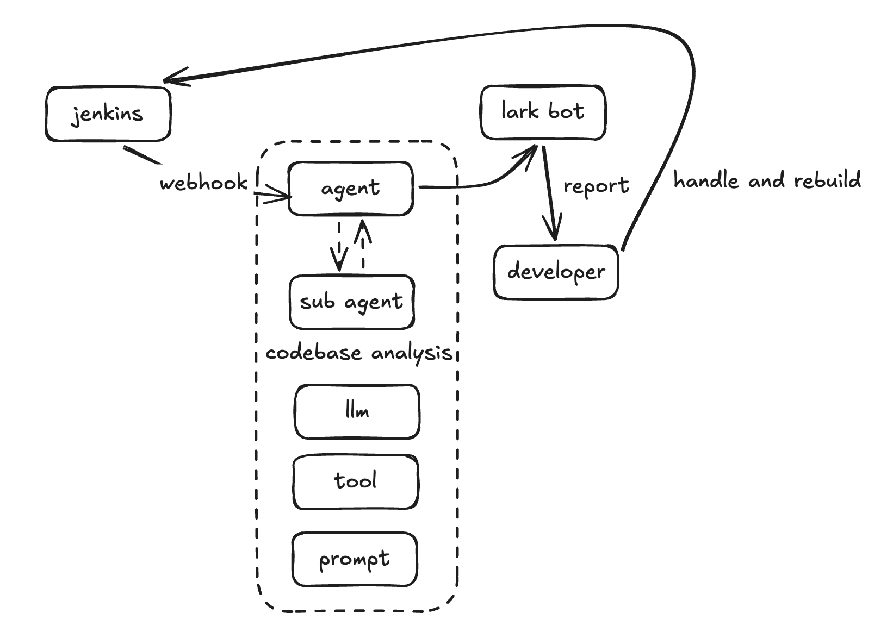
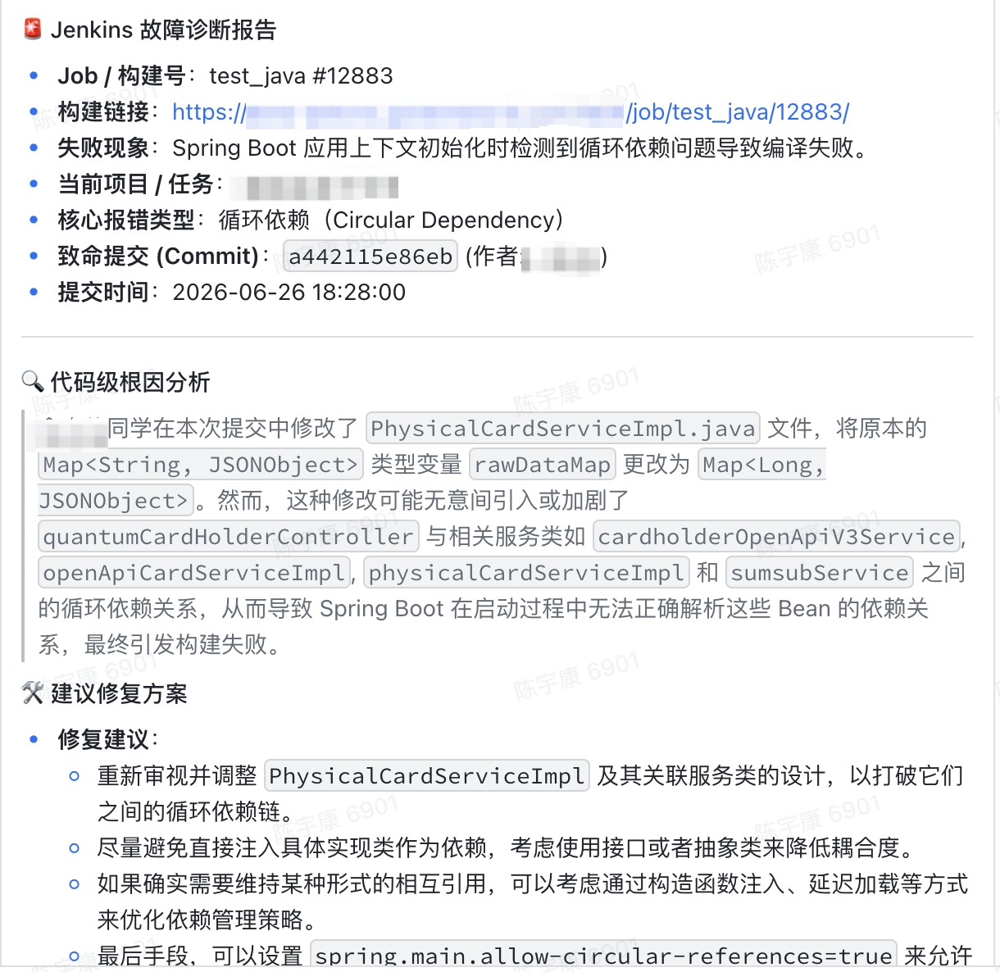

# Lark Agent Bot

帮助研发与运维人员定位和排查 CI/CD 及代码构建问题。

## 项目背景

随着业务规模扩大，代码仓库不断增长，代码构建的复杂度也随之提升。研发与运维人员需要投入大量时间来诊断和解决构建问题。

lark-agent-bot 提供了一种高效排查 CI/CD 问题的方式。

## 系统架构



系统将 Jenkins 构建事件、智能体辅助的代码库分析和飞书通知串联起来：

1. **事件接收（webhook）**：Jenkins 将构建事件发送到 Webhook 服务，启动问题排查流程。
2. **问题分析（analysis）**：主智能体协调排查流程，并将代码库分析委派给子智能体。结合大语言模型、工具和面向特定任务的提示词，检查构建日志及相关代码变更，定位可能的原因并提出修复建议。
3. **报告推送（report）**：通过飞书机器人发送分析结果，方便开发者在聊天中查看排查结论。
4. **开发者反馈（feedback）**：开发者查看报告、修复问题，并触发新的 Jenkins 构建以验证修复结果。

构建失败 Webhook 会分析事件中 `build_number` 指定的那次构建。重新构建卡片会跟踪 Jenkins 队列项及其对应的构建，只有当该次构建以 `SUCCESS` 状态完成时，才会将卡片标记为已解决。如果构建结果为 `FAILURE`、`ABORTED`，或队列任务被取消，卡片将保持未解决状态。

重新构建的尝试及结果保存在 `BUILD_TRACKER_DB` 指定的 SQLite 数据库中（默认路径为 `logs/builds.sqlite3`）；机器人重启后会继续跟踪尚未完成的尝试。在容器中运行时，请将该数据库存放在持久化存储中。

如果 Webhook 可从外部访问，请设置 `WEBHOOK_TOKEN`，并配置 Jenkins 在调用两个构建事件端点时，通过 `X-Webhook-Token` 请求头发送相同的值。如果未设置此项，请在网络层限制 Webhook 的访问范围。

## 快速开始

机器人与应用开发可参考 [Lark 示例项目](https://github.com/larksuite/lark-samples.git)。

### 前置条件

- Python 3.14+
- 飞书机器人 App ID，参见[快速开发机器人](https://github.com/larksuite/lark-samples.git)
- 飞书机器人 App Secret，参见[快速开发机器人](https://github.com/larksuite/lark-samples.git)
- 飞书卡片 ID，参见[卡片搭建工具 Card Kit](https://open.feishu.cn/cardkit?from=open_docs_header)

### 运行启动脚本

```bash
./bootstrap.sh
```

### 与机器人对话

通过与飞书机器人进行自然语言对话，排查 CI/CD 问题。



## 许可

- Apache 2.0
