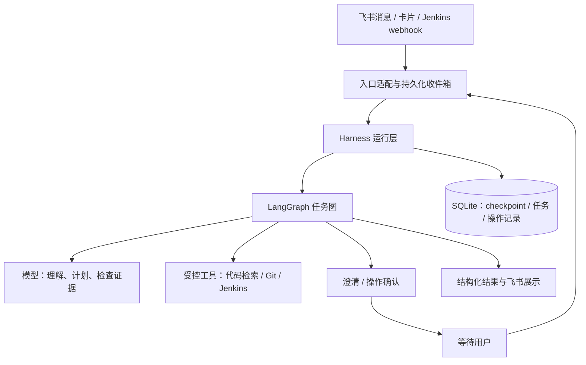

# DevOps Agent V3：基于 Harness + LangGraph 的有状态助手

## 1. 目标与架构

新版面向通过飞书咨询项目代码、排查构建失败和执行打包的开发、运维人员，实现：

- **记住任务**：跨消息、跨重启保留项目、构建、调查进度和证据。
- **主动澄清**：信息不足时提出具体问题，用户补充后继续原任务。
- **基于代码回答**：支持代码逻辑、调用关系、配置及变更影响问答，给出可核验的代码引用。
- **按证据推进**：自主选择工具、检查结果、补充调查；证据不足时明确结论边界。
- **受控执行构建**：保留打包、重建及结果追踪，执行前确认具体操作。

V1 缺少跨请求状态；V2 只有日常问答使用内存 checkpoint，路由不读取完整任务上下文，代码分析绑定失败构建报告。V3 将这些能力统一到任务循环。



职责划分：

| 层 | 职责 |
|---|---|
| LangGraph | 状态转换、条件分支、调查循环、中断与恢复 |
| Harness | 上下文组装、工具策略、预算、超时、幂等、恢复和观测 |
| 模型 | 理解目标、提出调查步骤、选择工具、综合证据 |
| 工具与适配器 | 执行受限的代码、Git、Jenkins、飞书操作 |
| 飞书展示 | 进度、澄清、确认和结果卡片 |

首期采用单执行实例和 SQLite；不自动修改代码、提交 PR、部署或回滚，不引入向量数据库和自主多 Agent 调度。

## 2. 会话、状态与反问

### 2.1 会话与任务

区分三种标识：

- `conversation_id`：对话上下文，保存近期交流及摘要。
- `task_id`：一次明确任务，对应 LangGraph 的 `thread_id`。
- `run_id`：一次消息驱动的执行，用于观测与预算统计。

飞书会话按 `chat_id + open_id + root_message_id` 隔离；无话题标识时使用该用户在当前聊天中的默认会话。同一会话首期只有一个活动任务。

任务完成后，追问创建新任务并显式继承相关事实和证据。用户要求“新问题”时清空项目等默认槽位；用户取消时终止当前任务，不影响已经提交的 Jenkins 构建。

Webhook 创建独立的系统任务，绑定指定 Job 和构建号。用户引用其报告追问时，创建个人任务并继承允许读取的报告上下文，不直接修改系统任务。

### 2.2 状态模型

内部使用 `TypedDict` 定义 Graph State，消息字段使用 LangGraph 消息 reducer；入口、模型决策和工具结果使用 Pydantic 校验。

| 状态组 | 核心内容 |
|---|---|
| 身份与版本 | 会话、任务、发起者、来源、状态版本 |
| 对话 | 当前输入、近期消息、历史摘要 |
| 任务 | 目标、状态、计划、已完成步骤 |
| 目标资源 | 项目 alias、分支、commit SHA、Job、构建号 |
| 待输入 | 问题 ID、问题类型、缺失字段、候选项、有效期 |
| 调查 | 已执行工具、证据索引、假设、证据缺口 |
| 执行控制 | 预算、重试次数、待确认操作、操作 ID |
| 输出 | 最终回答、引用、构建结果、错误信息 |

任务状态统一为：

`running / waiting_input / waiting_approval / waiting_external / completed / failed / cancelled`

checkpoint 保存恢复所需状态；完整日志、代码片段等大内容另存制品，状态中只保存引用。凭据不进入模型上下文或 checkpoint。

LangGraph 的 checkpoint 用于线程内恢复；跨任务信息由应用显式管理。依据：[LangGraph Persistence](https://docs.langchain.com/oss/python/langgraph/persistence)。

### 2.3 反问策略

先读取已有状态、项目目录和可查询信息，再判断是否需要用户补充：

- 项目存在多个合理候选：展示候选项目及区分信息。
- 用户指定“这次失败”，但缺少唯一构建上下文：询问构建号或链接。
- 用户明确要求“最新失败”：查询一次并固定构建号，后续不漂移。
- 代码问答未指定分支：使用配置默认分支，并在结果中展示解析后的 SHA。
- 缺少的信息可由工具查得：直接查询，不反问。
- 工具故障：报告故障或降级，不伪装成用户信息缺失。

每轮优先询问一个阻塞问题。连续三轮仍无法确定目标时，说明已知信息与所需输入格式，结束当前任务。

澄清问题通过 `interrupt()` 暂停，使用原 `thread_id` 和 `Command(resume=...)` 恢复。中断节点只等待输入，副作用放到后续节点，因为恢复会重新进入中断节点。依据：[LangGraph Interrupts](https://docs.langchain.com/oss/python/langgraph/interrupts)。

飞书文本和按钮都可以补充答案；恢复前校验用户、任务和问题 ID。过期、重复或他人提交的答案不能推进任务。

## 3. 任务图与代码能力

### 3.1 核心执行循环

```text
接收输入 → 理解目标并更新槽位 → 检查上下文
  ├─ 关键歧义 → 澄清 → 暂停 → 恢复检查
  └─ 信息充分 → 规划下一步
                  ├─ 读取工具 → 检查证据 ──┐
                  │              ├─ 不足 ─┘
                  │              └─ 充分 → 生成回答
                  ├─ 构建操作 → 确认 → 提交 → 等待结果
                  └─ 预算耗尽 → 输出已有发现及缺口
```

模型输出结构化的下一步决策，包含动作、参数、理由和预期获取的信息。Harness 校验工具名称、参数、权限及预算后执行，模型不能直接指定本地工作目录或任意命令。

保留意图标签用于观测和展示，但不再由单次分类决定固定专家路径。一个任务可以先查询构建、再检索代码、最后回答追问。

### 3.2 受控代码工具

首期提供：

- 项目目录查询：返回 alias、描述、默认分支及允许的能力。
- 文件列表与文本搜索：支持路径过滤和结果数量限制。
- 按行读取文件：返回文件路径、行号和 commit SHA。
- Git 提交、diff、blame 查询。
- Jenkins Job、指定构建、错误日志及 changeSet 查询。

工具统一返回 `status、data、evidence、error、truncated`，区分空结果、目标不存在、权限不足、超时和外部服务异常。

代码读取绑定不可变 SHA；使用 Git 对象读取文件，不切换或重置共享工作目录。必要的 fetch 按仓库串行执行。检索应限制在服务端配置的仓库范围，拒绝路径越界，不读取凭据文件或执行仓库脚本。

问答流程：

1. 明确项目与版本。
2. 查找入口、符号及配置。
3. 沿实际依赖继续读取，建立证据链。
4. 检查回答中的关键结论是否有证据支持。
5. 输出解释、引用及尚未确认的部分。

引用使用 `alias@SHA:path:Lx-Ly`；存在代码托管地址时生成永久链接。每条证据包含来源、版本、范围和工具调用 ID。

“代码声明的行为”和“运行环境的实际行为”分别表述；配置文件不能证明生产环境一定使用该配置。

### 3.3 深度分析与上下文控制

Claude/Cursor 保留为可选深度分析后端，不作为默认路径。只有具备隔离的只读工作区、超时控制和可核验结果时才启用；现有允许 Bash 的配置不能直接视为只读保证。

子执行器返回结构化发现和引用；主图重新读取关键引用后采纳，不直接转发未经验证的结论。

默认单次执行预算：

- 最多 12 次模型调用、20 次工具调用。
- 普通工具超时 30 秒，深度分析超时 180 秒。
- 同一可重试读取最多重试两次。
- 交互调查最多运行 5 分钟；等待用户和构建不计入该时长。

接近模型上下文限制时，压缩旧消息和重复观察，保留当前目标、待回答问题、关键事实、证据索引及尚未解决的假设。摘要不能代替原始证据。

## 4. 构建、持久化与接入

### 4.1 构建操作

所有打包和重建走统一操作服务：

1. 解析具体 alias、Job、操作类型及可支持参数。
2. 展示具体操作并等待用户确认。
3. 校验确认绑定的操作摘要、操作者及权限。
4. 持久化操作记录，再提交 Jenkins。
5. 保存 queue ID，复用现有 `BuildTracker` 追踪结果。

确认默认十分钟有效；目标或参数改变后必须重新确认。首期沿用配置 Job 的构建行为，不宣称可以构建任意分支或指定 commit。

操作记录使用稳定 `operation_id`，覆盖重复消息、卡片点击和恢复执行。提交超时或“Jenkins 已接收但本地未记录”时标记 `unknown`，禁止自动再次提交；可确定关联到已有队列时恢复追踪，否则要求人工核对。SQLite 与 Jenkins 之间无法提供跨系统原子性，设计不承诺 exactly-once。

构建入队只表示已受理；只有实际结果为 `SUCCESS` 才标记成功。失败、中止、取消和未知结果保留独立状态。

### 4.2 持久化与恢复

新增持久化数据库 `logs/agent.sqlite3`，使用 SQLite checkpoint 后端及应用表保存：

- 会话和活动任务映射。
- 消息收件箱及去重键。
- 待输入问题、操作记录和待发送结果。
- 任务运行状态及制品引用。

沿用 `logs/` 持久卷；新增 SQLite checkpoint 依赖，通过 `uv` 锁定兼容版本。

当前飞书处理和 webhook 位于不同线程与事件循环。新版由一个专用执行循环持有 Graph 和异步数据库资源，入口通过持久化收件箱投递事件，避免跨循环共享异步连接。同一任务串行执行，不同任务默认最多并发四个。

启动时恢复未完成收件箱、可恢复任务、待发送结果和构建监控；等待用户的任务保持暂停。checkpoint 不替代任务调度或外部操作记录。

### 4.3 接入接口与迁移

新增统一入口：

- `handle_event(event) -> AgentResponse`
- `resume_task(task_id, question_id, actor, answer) -> AgentResponse`

响应包含 `task_id、status、content、citations、question、operation`；澄清与等待确认属于正常状态。

代码主要放入 `app/agents/devops/v3/`；运行层放入 `app/agents/harness/`；外部操作仍由 `app/tools/` 提供，飞书和 webhook 只负责协议转换。

复用 Git、Jenkins、构建追踪和图片识别能力。图片识别结果作为带来源的用户输入，后续进入相同任务图。

使用 `DEVOPS_AGENT_VERSION=v2|v3` 灰度切换，默认保持 V2。V3 内部采用结构化结果，兼容层适配已有卡片；责任人信息使用经过证据检查的字段，逐步替换 Markdown `METADATA` 解析。DDL 通知流程不在首期重构范围内。

V2 内存会话不迁移。回退版本前暂停 V3 新任务及操作，已有 V3 构建继续由持久化追踪器监控。

## 5. 验证与验收

使用 `unittest`、异步测试及 mock，禁止依赖真实模型、Jenkins 或飞书进行自动化验证。

必测场景：

- 缺项目时提出候选问题，补充后继续原任务；已知信息不重复询问。
- 同一用户多轮承接项目，不同用户和任务不串状态。
- 澄清期间重启后可恢复；重复、过期和越权回复不推进任务。
- 指定构建号和 SHA 始终保持一致，不能漂移到最新构建或工作区版本。
- 代码回答引用真实文件与行范围；证据不足、仓库不可用和搜索为空时正确降级。
- 工具超时、预算耗尽和上下文压缩后仍能输出可靠的阶段结果。
- 重复消息、重复 webhook、重复确认及节点恢复不重复提交构建。
- Jenkins 提交结果不明时进入 `unknown`，不自动重试。
- 路径越界、日志或源码中的提示注入不能扩大工具权限。
- 原有精确构建分析、重建结果和 webhook 测试继续通过。

建立至少 30 个可复现评估案例，覆盖代码问答、多轮澄清、排障及构建。上线门槛为：所有隔离、确认和重复提交案例通过；所有代码引用可解析；至少 90% 案例满足预先定义的任务完成标准。

记录任务状态、澄清次数、工具错误、模型调用量、耗时、引用有效率及未知操作数；不记录模型思维链、密钥或完整敏感日志。

实施顺序为：状态与恢复基础 → 受控代码问答 → 多轮澄清 → 构建统一入口 → 故障恢复与评估 → 灰度切换。每阶段以对应场景通过作为进入下一阶段的条件。
